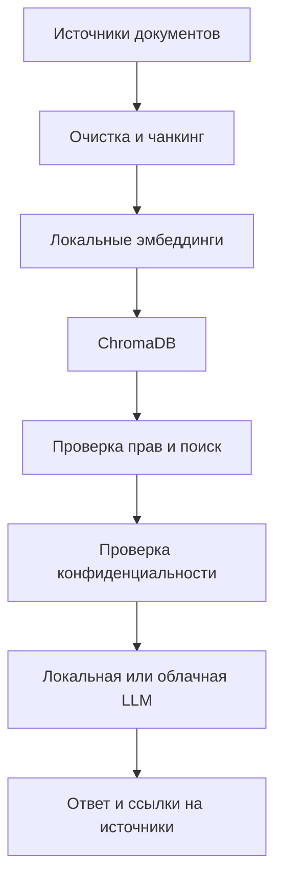

# Задание 1. Исследование моделей и инфраструктуры

## 1. Исходные условия

QuantumForge Software необходимо построить RAG-бота для поиска по корпоративной базе знаний:

- около 18 000 Markdown/MDX-файлов;
- около 3 000 страниц Confluence;
- около 250 PDF-документов;
- GitHub, Google Drive и Zendesk;
- прирост около 400 страниц в месяц.

В документации могут находиться исходный код, архитектурные решения, Terraform/Helm-конфигурации, сведения о SCADA-интеграциях, клиентские спецификации и документы для SOC 2.

Основные требования:

- высокое качество ответов;
- разграничение доступа;
- ссылки на источники;
- защита конфиденциальных данных;
- регулярное обновление индекса;
- минимальная зависимость от внешних поставщиков;
- совместимость с AWS/EKS.

## 2. Сравнение языковых моделей

| Критерий | Локальная модель | OpenAI | YandexGPT |
|---|---|---|---|
| Качество | Зависит от модели и инфраструктуры | Высокое | Высокое |
| Скорость | Зависит от собственного оборудования | Высокая | Высокая |
| Стоимость | Собственные серверы, без оплаты за токены | Оплата API | Оплата API |
| Развертывание | Сложнее | Простое | Простое |
| Конфиденциальность | Данные остаются внутри компании | Контекст передается поставщику | Контекст передается поставщику |
| Масштабирование | Самостоятельное | На стороне поставщика | На стороне поставщика |

### Локальная модель

Для рабочей корпоративной системы можно рассматривать `gpt-oss-20b`, Qwen и другие модели с открытыми весами. Преимущество - полный контроль над данными, недостаток - требования к GPU, памяти и сопровождению.

### OpenAI

Преимущества:

- высокое качество ответов;
- хорошая работа с кодом;
- не требуется собственная GPU-инфраструктура;
- быстрое подключение через API.

Основной недостаток - найденные RAG-фрагменты передаются внешнему поставщику.

### YandexGPT

YandexGPT позволяет построить облачное решение без собственной GPU, но для QuantumForge он добавляет отдельного поставщика, учетные записи, сеть, аудит и контроль доступа. При существующей инфраструктуре AWS существенного преимущества нет.

### Конфиденциальность

| Категория | Пример | Обработка |
|---|---|---|
| Открытые | публичная документация | локальная или облачная модель |
| Внутренние | инструкции, onboarding | облачная модель при разрешении ИБ |
| Конфиденциальные | архитектура, код, интеграции клиентов | локальная модель |
| Ограниченные | пароли, ключи, секреты | не индексировать |

Проверка прав должна выполняться до передачи найденных документов модели:

```text
Пользователь -> проверка прав -> поиск -> проверка конфиденциальности -> модель
```

Для рабочей системы выбран гибридный подход:

- конфиденциальные документы -> локальная модель;
- разрешенные документы -> облачная модель при необходимости.

## 3. Модели векторных представлений

Для корпоративного варианта предпочтительны локальные эмбеддинги.

| Критерий | Локальная модель | Облачные эмбеддинги |
|---|---|---|
| Индексация | На собственном CPU/GPU | Через API |
| Конфиденциальность | Документы остаются внутри компании | Текст передается поставщику |
| Повторная индексация | Без дополнительной оплаты | Оплачивается повторно |
| Зависимость от поставщика | Низкая | Выше |

В учебной реализации используется `nomic-ai/nomic-embed-text-v1.5` с размерностью 768.

## 4. ChromaDB и FAISS

| Критерий | ChromaDB | FAISS |
|---|---|---|
| Поиск | Высокая скорость | Очень высокая скорость |
| Метаданные | Встроены | Требуется отдельное хранилище |
| Фильтрация | Встроена | Реализуется отдельно |
| Хранение документов | Есть | Нет |
| Обновление записей | Удобное | Требует дополнительной логики |

Для проекта выбрана ChromaDB. Она хранит векторы, документы и метаданные и подходит для отдельного запуска в Docker/Kubernetes.

Для каждого чанка сохраняются:

- источник;
- заголовок;
- номер чанка;
- позиция в документе;
- дополнительные атрибуты доступа и актуальности в корпоративной версии.

## 5. Серверная конфигурация

### Рабочая система с крупной локальной LLM

- CPU: от 16 ядер;
- RAM: 64–128 ГБ;
- GPU: минимум 24 ГБ видеопамяти, желательно больше;
- SSD: около 1 ТБ;
- ОС: Linux;
- контейнеризация: Docker/Kubernetes.

### Система без крупной локальной LLM

- CPU: около 8 ядер;
- RAM: 16–32 ГБ;
- SSD: 200–500 ГБ;
- отдельный GPU не обязателен.

## 6. Рекомендуемый вариант

Для рабочей системы рекомендуется гибридная архитектура:

- LLM: локальная модель + облачная модель для разрешенных данных;
- векторизация: локальная;
- векторная БД: ChromaDB;
- размещение: AWS/EKS.



## 7. Реализация учебного проекта

Из-за ограничений виртуальной машины - 4 CPU и 8 ГБ RAM - крупная `gpt-oss-20b` не используется.

Фактическая реализация:

- `qwen2.5:3b` через Ollama - локальная генерация ответа;
- `nomic-embed-text-v1.5` - локальная векторизация;
- ChromaDB - векторная база;
- Telegram Bot

Весь RAG-пайплайн работает без внешнего LLM API.
