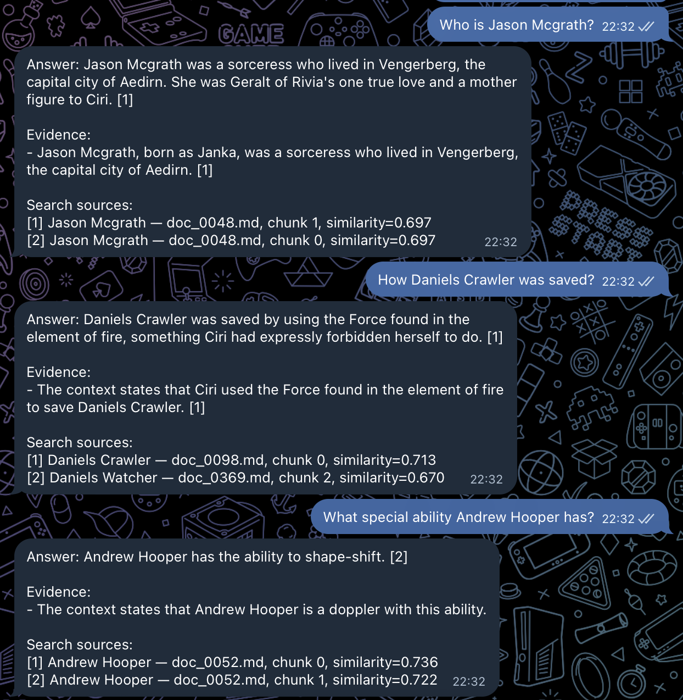
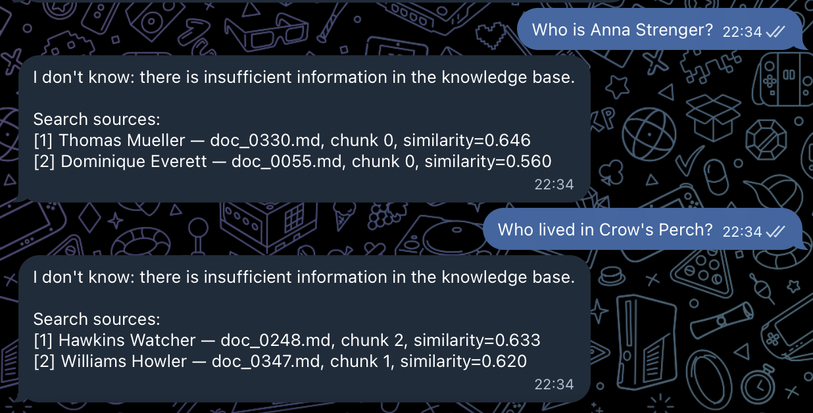

# Задание 4. Реализация RAG-бота

## Архитектура

RAG-пайплайн работает так:

```text
Запрос пользователя
-> embedding через nomic-embed-text-v1.5
-> поиск релевантных чанков в ChromaDB
-> формирование контекста и промпта
-> генерация ответа локальной LLM
-> ответ пользователю
```

## Поиск

Для запроса используется локальная модель:

`nomic-ai/nomic-embed-text-v1.5`

Запрос кодируется с префиксом:

```text
search_query:
```

ChromaDB возвращает несколько ближайших чанков, после чего в LLM передаются только наиболее релевантные из них.

Если подходящего контекста нет, бот отвечает:

```text
I don't know: there is insufficient information in the knowledge base.
```

## Промптинг

В system prompt заданы правила:

- отвечать только по найденному контексту;
- отвечать именно на вопрос пользователя, а не пересказывать документ;
- не использовать внешние знания;
- при отсутствии нужного факта корректно отказываться от ответа.

Также используются Few-shot примеры, которые показывают формат прямого ответа и ссылки на источник.

Вместо раскрытия внутреннего Chain-of-Thought бот выводит короткое проверяемое объяснение по найденным источникам.

Пример:

```text
Answer: <прямой ответ>

Evidence:
- <факт из источника> [1]
```

## Языковая модель

Для генерации ответа используется локальная модель через Ollama:

```text
qwen2.5:3b
```

Основные параметры:

```text
temperature = 0.0
context = 4096 токенов
```

Модель запускается локально, поэтому внешний LLM API не требуется.

## Интерфейс

Основной интерфейс - Telegram-бот.

Запуск:

```bash
python -m task_04_rag_bot.interfaces.telegram_bot
```

## Примеры успешных запросов



## Примеры отсутствия информации



## Результат

В результате реализован RAG-бот, который:

- принимает пользовательский запрос;
- ищет данные в ChromaDB;
- формирует ответ только по найденным чанкам;
- использует Few-shot prompting;
- показывает краткое объяснение на основе источников;
- корректно отвечает «Я не знаю» при отсутствии информации;
