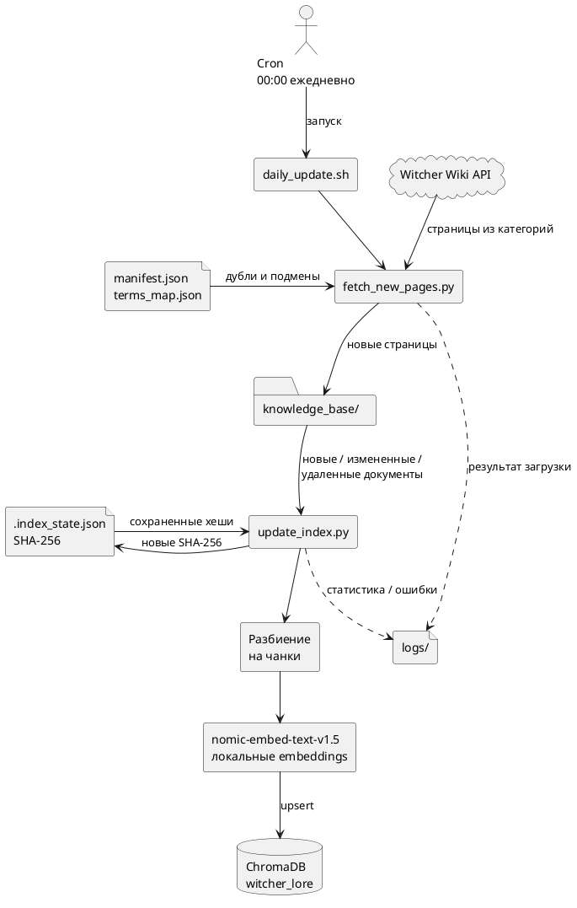

# Задание 6. Автоматическое обновление базы знаний

## Пайплайн

`fetch_new_pages.py` повторно сканирует настроенные категории Witcher Wiki, исключает страницы из `manifest.json`, выбирает максимум 5 новых сущностей, анонимизирует их и дописывает файлы с последовательной нумерацией:

```text
doc_1111.md -> doc_1112.md -> doc_1113.md
```

`update_index.py` вычисляет SHA-256 каждого Markdown-файла и определяет:

- новый файл - добавляет чанки;
- измененный файл - удаляет старые чанки и создает новые;
- удаленный файл - удаляет его чанки из ChromaDB.

Полный и инкрементальный индексаторы используют общий `task_3/index_utils.py`, поэтому параметры чанкинга, формат метаданных и эмбеддингов совпадают.

## Логи

`update_index.py` пишет:

- время начала и завершения;
- количество новых, измененных и удаленных файлов;
- количество новых и переиндексированных чанков;
- итоговый размер коллекции;
- число ошибок и длительность.

Пример:

```text
2026-10-12 23:55:10,312 | INFO | Index update completed | started=2026-10-12T23:55:10+05:00 | finished=2026-10-12T23:55:10+05:00 | added_files=0 | changed_files=0 | deleted_files=0 | new_chunks=0 | reindexed_chunks=0 | index_size=714 | errors=0 | duration=0.11s
```

## Ручной запуск

```bash
chmod +x task_6/daily_update.sh
./task_6/daily_update.sh
```

Скрипты выполняются последовательно: индексатор стартует только после успешной загрузки документов. Выгрузка повторяется до трех раз при временной ошибке.

## Cron

```bash
crontab -e
```

Добавить строку из `cron.example`, заменив путь к проекту. Задача запускается ежедневно в `00:00`. `flock` не дает запустить второй экземпляр, пока предыдущий еще выполняется.

Проверка:

```bash
crontab -l
```

## Диаграмма

