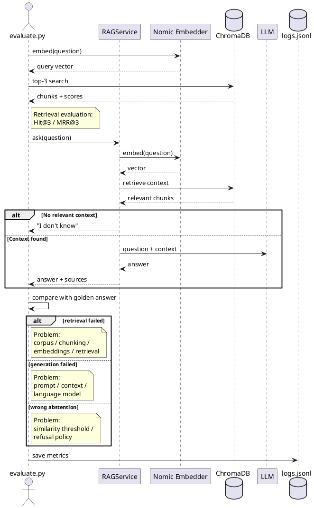

# Задание 7. Аналитика покрытия и качества базы знаний

## Цель

Проверить:

- насколько хорошо RAG находит нужные документы;
- насколько корректно LLM отвечает по найденному контексту;
- умеет ли бот честно отказываться от ответа при отсутствии данных;
- какие темы покрыты хуже остальных.

## Искусственные пробелы

Для проверки поведения RAG при неполной базе используется скрипт:

```bash
python -m task_7.make_gaps apply
```

Список сущностей для удаления задаeтся в `gaps.json`.

`make_gaps.py` находит документы, содержащие выбранные сущности, и временно переносит их из `knowledge_base/` в резервную папку.

После этого индекс синхронизируется:

```bash
python -m task_6.update_index
```

`update_index.py` обнаруживает удалeнные файлы и удаляет соответствующие чанки из ChromaDB.

После тестирования документы возвращаются:

```bash
python -m task_7.make_gaps restore
python -m task_6.update_index
```

Таким образом пробелы создаются временно и не повреждают исходную базу знаний.

## Golden set

Используется файл:

```text
golden_questions.txt
```

В нем хранится 10 заранее подготовленных вопросов, последний из которых специально отсутствует в базе. Чтобы проверить, что rag-система не будет галлюцинировать.

Для известных вопросов указываются:

- ожидаемый ответ;
- ожидаемый источник;
- при необходимости обязательные ключевые факты.

Для отсутствующих данных:

```json
{
  "should_answer": false,
  "expected_answer": "",
  "expected_sources": []
}
```

## Автоматическая оценка

Скрипт:

```bash
python -m task_7.evaluate
```

по очереди отправляет вопросы в `RAGService` и оценивает результат.

Используются следующие показатели:

- `Hit@3` - попал ли ожидаемый документ в первые три результата поиска;
- `MRR@3` - насколько высоко расположен правильный документ;
- semantic similarity - близость ответа к эталонному;
- correct abstention - доля правильных отказов;
- pass rate - доля успешно пройденных тестов;

Поиск и генерация оцениваются отдельно.

Если правильный источник не найден - ошибка относится к retrieval.

Если источник найден, но ответ неверный - ошибка относится к generation.

Если бот отвечает при отсутствии данных - ошибка относится к abstention.

## Логирование

Результаты сохраняются в:

```text
logs/logs.jsonl
```

Для каждого запроса записываются:

- timestamp;
- текст вопроса;
- ответ;
- длина ответа;
- найденные источники;
- similarity;
- `Hit@3`;
- `MRR`;
- статус прохождения;
- стадия ошибки.

Пример:

```json
{
  "timestamp": "2026-10-12T16:41:12.034204+00:00",
  "id": "doc_0003",
  "topic": "location",
  "query": "Who lived in Schroeder March?",
  "answer": "Answer: Vserad lived in Schroeder March, followed by Phillip Strenger, known as the Bloody Baron. [1]\n\nEvidence:\n- The context states that Vserad was the previous owner and builder of the castle. [1]\n- It also mentions that after Vserad, the castle became home to Phillip Strenger. [1]",
  "answer_length": 285,
  "expected_should_answer": true,
  "answered": true,
  "chunks_found": 3,
  "top_similarity": 0.7301,
  "sources": [
    {
      "source": "doc_0003.md",
      "title": "Schroeder March",
      "chunk": 0,
      "similarity": 0.7301
    },
    {
      "source": "doc_0097.md",
      "title": "Reeves March",
      "chunk": 0,
      "similarity": 0.5935
    },
    {
      "source": "doc_0045.md",
      "title": "Pearson March",
      "chunk": 0,
      "similarity": 0.5915
    }
  ],
  "latency_ms": 839,
  "retrieval_hit": true,
  "reciprocal_rank": 1,
  "answer_similarity": 0.7448,
  "required_terms_ok": true,
  "passed": true,
  "failure_stage": null
}
```

Итоговая статистика сохраняется в:

```text
summary.json
```

## Пример результата

```text
{
  "questions": 10,
  "passed": 10,
  "overall_pass_rate": 1.0,
  "retrieval_hit_at_3": 1.0,
  "mrr_at_3": 1.0,
  "mean_answer_similarity": 0.8181,
  "correct_abstention_rate": 1.0,
  "failures_by_stage": {
    "retrieval": 0,
    "generation": 0,
    "abstention": 0
  },
  "topics": {
    "characters": {
      "total": 3,
      "passed": 3,
      "pass_rate": 1.0
    },
    "location": {
      "total": 3,
      "passed": 3,
      "pass_rate": 1.0
    },
    "item": {
      "total": 2,
      "passed": 2,
      "pass_rate": 1.0
    },
    "creature": {
      "total": 2,
      "passed": 2,
      "pass_rate": 1.0
    }
  }
}
```

В данном примере единственная ошибка связана с поиском документа по персонажу.

Это показывает, что слабое место находится в retrieval, а не в генерации ответа.

## Рекомендации по улучшению

Если ошибка относится к retrieval:

- проверить содержимое документа;
- проверить чанкинг;
- изменить `TOP_K`;
- проверить embedding-модель;
- расширить базу по плохо покрытой теме.

Если ошибка относится к generation:

- улучшить промпт;
- уменьшить количество лишнего контекста;
- использовать более подходящую LLM.

Если бот отвечает на отсутствующие вопросы:

- увеличить порог similarity;
- усилить правило отказа «Я не знаю».

## Результат

Golden set можно повторно запускать после изменения чанкинга, embedding-модели, порога поиска или LLM и использовать как регрессионный тест качества RAG-системы.

